# Republic of the Philippines
# NATIONAL AVIATION ACADEMY OF THE PHILIPPINES
### The National Professional Institution for Aviation
### INSTITUTE OF COMPUTER STUDIES

---

# SYSTEM USER MANUAL
## LUPON TAGAPAMAYAPA CASE MANAGEMENT AND DISPUTE RESOLUTION INFORMATION SYSTEM (LUPON CMS)

---

## 1. SYSTEM OVERVIEW & GETTING STARTED

### 1.1 Purpose of the System
The **Lupon Tagapamayapa Case Management and Dispute Resolution Information System (Lupon CMS)** is a specialized web-based legal governance and conciliation management platform developed to streamline the dispute resolution workflows of Barangay Katarungang Pambarangay (KP) bodies. The system digitizes the filing, scheduling, conciliation lifecycle tracking, legal form generation, document storage, and Lupong Tagapamayapa Incentives Awards (LTIA) governance compliance tracking.

### 1.2 System Architecture & Environment
The system is built upon a high-performance modern web stack:
- **Backend Framework:** Laravel (PHP 8.2+) with Eloquent ORM & Spatie Role-Based Access Control (RBAC).
- **Frontend Architecture:** React (TypeScript) powered by Inertia.js, Tailwind CSS, Lucide Icons, and Radix UI components.
- **Database Engine:** MySQL Database Server with transaction-safe backups and soft-deletion protection.
- **AI Intelligence Integration:** Google Gemini 2.5 Flash API for automated optical document recognition (OCR) and metadata extraction.
- **Document Engine:** DomPDF & Ghostscript for standard legal form generation and PDF rendering.
- **Clock Synchronization:** Philippine Standard Time (PST, UTC+8, Asia/Manila) synchronizer.

### 1.3 User Role & Access Rights Matrix

| System Module / Capability | Administrator Role | Data Encoder Role | Lupon Secretary Role |
| :--- | :---: | :---: | :---: |
| **Authentication & Profile Management** | Full Access | Full Access | Full Access |
| **Analytics Dashboard & Summary Metrics** | Full Access | Full Access | Full Access |
| **Personnel & User Management** | Full Access (Create, Edit, Delete) | View Only / No Access (403) | No Access (403) |
| **Roles & Permissions Matrix** | Full Access (Configure) | No Access (403) | No Access (403) |
| **Audit Trail Logs & IP Tracking** | Full Access (View, Search, Filter) | No Access (403) | No Access (403) |
| **Official PDF Report Generation** | Full Access (Export) | Full Access (Export) | Full Access (Export) |
| **LTIA Deadlines & Calendar Management** | Full Access | Full Access | Full Access |
| **Case Encoding & Status Lifecycle** | View Only | Full Access (Create, Update, Archive) | Full Access |
| **KP Legal Document Generator** | View Only | Full Access (Edit, Fill, Print) | Full Access |
| **Gemini AI Document Scan Ingestion** | View Only | Full Access (Upload, Extract, Save) | Full Access |
| **Document Drive & Custom Folders** | View Only | Full Access (Create, Upload, Delete) | Full Access |
| **Document Version Restoration** | View Only | Full Access (Inspect, Restore) | Full Access |
| **Database Backup Download (.JSON)** | Full Access | Full Access | Full Access |
| **Database Restoration (.JSON)** | Blocked (View-Only Guard) | Full Access (Authorized Restorer) | Blocked |

### 1.4 Minimum System Requirements
- **Client Machine:** Modern desktop, laptop, or tablet (Windows 10/11, macOS, Linux, or iPadOS).
- **Web Browser:** Google Chrome v110+, Mozilla Firefox v115+, Microsoft Edge v110+, or Safari v16+.
- **Network Connection:** Local Area Network (LAN) connection to local server or broadband internet connection (minimum 5 Mbps for Gemini AI scanning).
- **Screen Resolution:** 1280 × 720 minimum (1920 × 1080 recommended for multi-column dashboards).

---

## 2. ADMINISTRATOR WORKFLOW MANUAL

```
Republic of the Philippines
NATIONAL AVIATION ACADEMY OF THE PHILIPPINES
The National Professional Institution for Aviation
INSTITUTE OF COMPUTER STUDIES
```

### TABLE 1: USER MANUAL PROCEDURE FOR MODULE: ADMIN WORKFLOW

| Manual ID | Procedure Title | Step-by-Step User Instructions (Actions) | Expected System Response & Visual Output | Screenshot / Image Reference | Operational Guidelines & Remarks |
| :--- | :--- | :--- | :--- | :--- | :--- |
| **UM_ADM_01** | Administrator Login with Valid Credentials | 1. Open web browser and navigate to `/login`.<br>2. Enter registered Administrator Email (e.g., `admin@example.com`).<br>3. Enter valid account password in the password field.<br>4. Click **"Log in"**. | System authenticates credentials, initiates an encrypted session cookie, and redirects user to the main **Admin Dashboard** (`/dashboard`). The administrator's name, role badge (`Administrator`), and avatar are rendered on top-right navigation bar. | [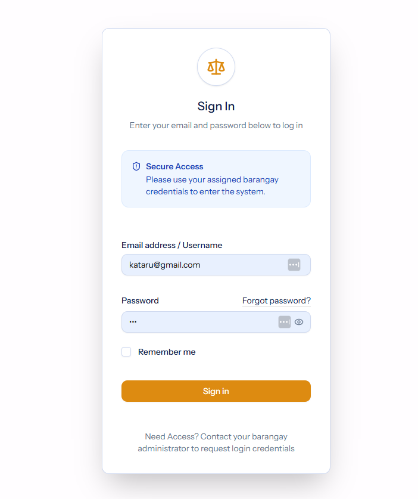](manual_images/image78.png)<br>[image78.png](manual_images/image78.png), [image45.png](manual_images/image45.png) | **Access Granted:** System validates against Spatie `Administrator` role guard. Failed attempts trigger rate-limiting safeguards. |
| **UM_ADM_02** | Administrator Login with Invalid Credentials | 1. Navigate to `/login`.<br>2. Input an unregistered email or an incorrect password.<br>3. Click **"Log in"**. | System rejects authentication, remains on login view, highlights the input box in red, and displays validation error: *"These credentials do not match our records."* | [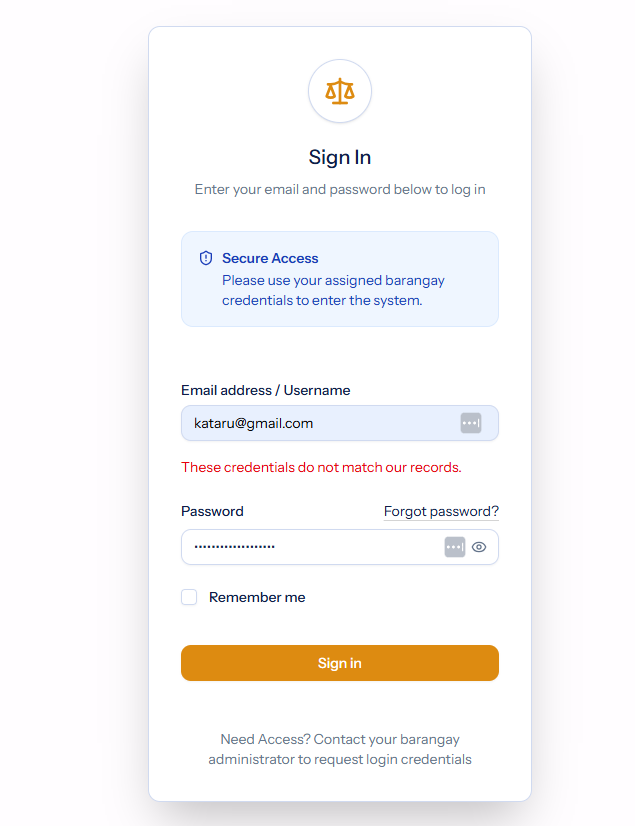](manual_images/image94.png)<br>[image94.png](manual_images/image94.png) | **Security Guard:** Password inputs are masked. Protects against brute-force attacks via Fortify throttle limits (5 failed attempts per minute). |
| **UM_ADM_03** | View Analytics Dashboard Metrics | 1. Authenticate as Administrator.<br>2. Navigate to **Dashboard** or click **Analytics** (`/analytics`) from sidebar.<br>3. Review the live metrics cards and graphical trend widgets. | System renders real-time KPI cards: **Total Cases Filed**, **Settled Cases**, **Pending Conciliations**, and **LTIA Compliance Score**. Interactive charts illustrate case breakdown by **Nature of Dispute** (Civil, Criminal, Administrative) and monthly filing trends. | [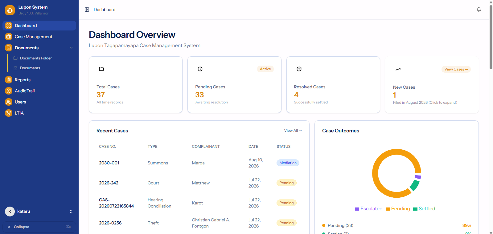](manual_images/image64.png)<br>[image64.png](manual_images/image64.png), [image93.png](manual_images/image93.png), [image42.png](manual_images/image42.png), [image13.png](manual_images/image13.png) | **Live Sync:** Data reflects current database totals with real-time updates when cases are settled or filed by Data Encoders. |
| **UM_ADM_04** | Master Personnel Directory Inspection | 1. On sidebar navigation drawer, click **"User Management"** / **"Personnel"** (`/users`).<br>2. View tabulated personnel directory. | System displays complete paginated table of all registered staff accounts showing: Avatar, Full Name, Email, Duty Group, Assigned Role Badge (`Administrator` in dark slate, `Data Encoder` in neutral, etc.), Account Status (`Active`/`Inactive`), and Registration Date. Summary counters display Total Personnel, Active Accounts, Inactive Accounts, and Lupon Members. | [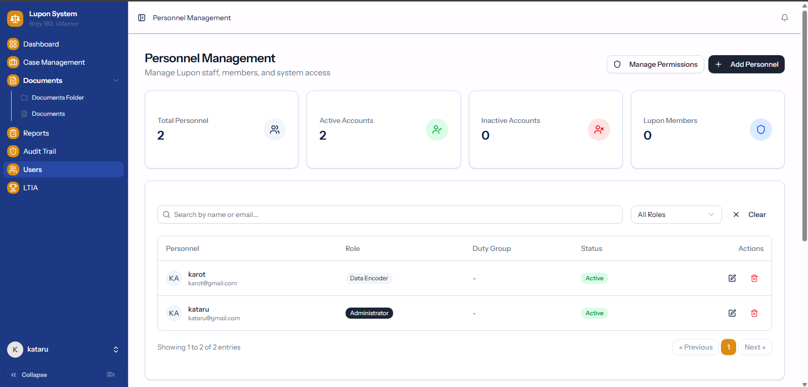](manual_images/image39.png)<br>[image39.png](manual_images/image39.png) | **Permission Guard:** Route is protected by `manage_users` permission. Unauthorized users are blocked with 403 Forbidden. |
| **UM_ADM_05** | User Management: Create New Personnel Account | 1. Navigate to **User Management** (`/users`).<br>2. Click **"+ Add New User"** button located at upper right.<br>3. In modal dialog, input **Full Name**, **Email Address**, and temporary **Password**.<br>4. Select assigned **Role** from dropdown (e.g., *"Data Encoder"*).<br>5. Select assigned **Duty Group** (e.g., *"Monday"*).<br>6. Click **"Save User"**. | System submits POST request to `/users`, stores hashed password in MySQL, logs an `ACCOUNT_CREATED` event in Audit Trail, closes modal, and renders the newly created user immediately in personnel list. | [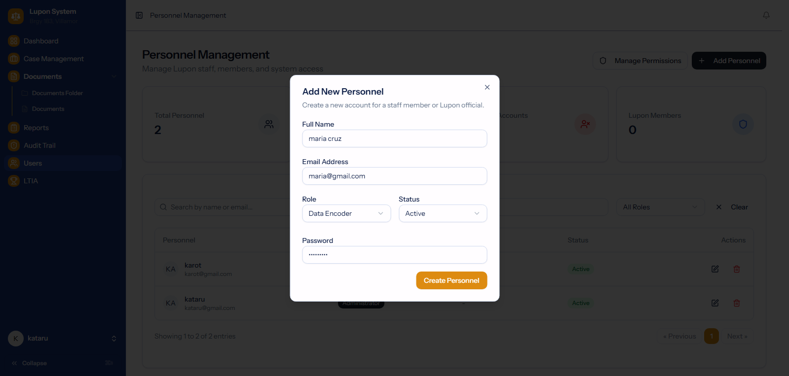](manual_images/image81.png)<br>[image39.png](manual_images/image39.png), [image81.png](manual_images/image81.png), [image23.png](manual_images/image23.png) | **Input Rules:** Passwords must meet security complexity rules. Assigned role automatically grants role-specific permissions. |
| **UM_ADM_06** | Account Creation: Duplicate Email / Format Validation | 1. Open **"Add New User"** modal.<br>2. Fill in name and password.<br>3. Input an email that is already registered to another user or type an invalid email format (e.g., `user@invalid`).<br>4. Click **"Save User"**. | System prevents form submission, focuses email input field with a red border, and displays backend validation message: *"The email has already been taken."* or *"Email address is already in use or invalid."* No duplicate record is written to the database. | [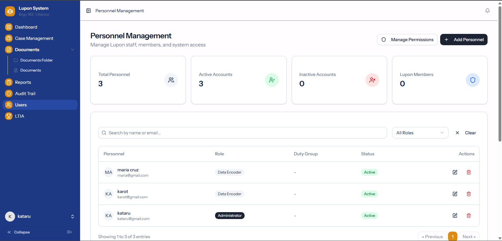](manual_images/image36.png)<br>[image36.png](manual_images/image36.png), [image60.png](manual_images/image60.png), [image9.png](manual_images/image9.png) | **Integrity Check:** Database enforces unique constraint on `users.email` preventing duplicate identity creation. |
| **UM_ADM_07** | User Management: Edit Account Details | 1. In Personnel Management table (`/users`), locate target user record.<br>2. Click **"Edit"** (pencil icon) button on action column.<br>3. In dialog, update user parameters (e.g., Change Role, Duty Group, or Account Status to `Inactive`).<br>4. Leave password blank to retain current password.<br>5. Click **"Save Changes"**. | Modal closes, updated data immediately reflects on personnel table, a success banner appears, and an `UPDATE_USER` entry is recorded in Audit Trail. | [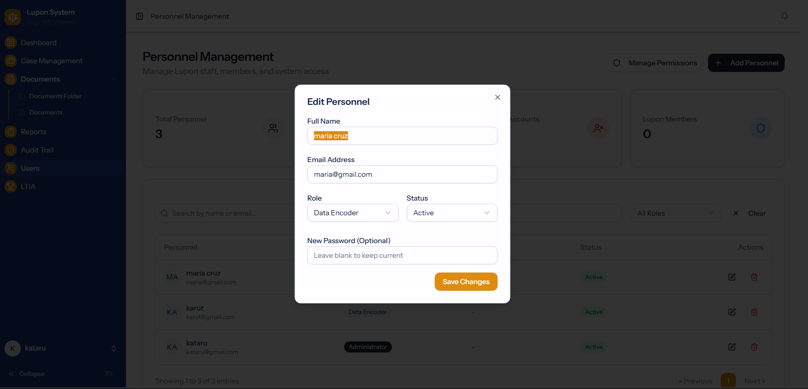](manual_images/image92.png)<br>[image92.png](manual_images/image92.png), [image32.png](manual_images/image32.png), [image46.png](manual_images/image46.png) | **Audit Compliance:** Changes to administrative roles and status changes are permanently logged with Admin User ID. |
| **UM_ADM_08** | Role & Permission Matrix Configuration | 1. Navigate to **"Roles & Permissions"** from sidebar or click **"Permissions Matrix"** on Personnel page (`/roles-permissions`).<br>2. View dynamic matrix displaying roles (`Administrator`, `Data Encoder`) against permission checkboxes (`view cases`, `edit cases`, `delete cases`, `view audit trail`, etc.).<br>3. Toggle access checkboxes to adjust permissions.<br>4. Click **"Save Changes"**. | System updates `role_has_permissions` table in database, reloads access cache, logs `UPDATE_PERMISSIONS` in audit log, and displays success notification: *"Role permissions updated successfully."* | [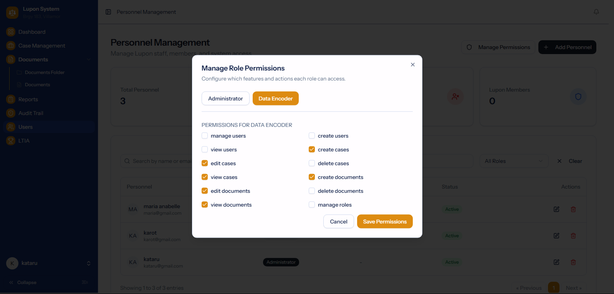](manual_images/image72.png)<br>[image72.png](manual_images/image72.png), [image85.png](manual_images/image85.png), [image44.png](manual_images/image44.png) | **RBAC Security:** Route endpoints strictly enforce permissions. Revoking a permission instantly restricts route access for that role. |
| **UM_ADM_09** | System Audit Trail & Security Log Inspection | 1. Click **"Audit Trail"** (`/audit`) on sidebar navigation.<br>2. Review chronological log table. | System renders historical security logs detailing: Log ID, Timestamp (PST), Acting User Name & Role, Action Type Badge (`LOGIN`, `CREATE`, `UPDATE`, `DELETE`, `BACKUP`, `SECURITY_REJECTED`), Target Module (`Cases`, `Documents`, `Personnel`), Activity Details, and Source Client IP Address. Summary cards display Total Activities, Today's Logs, and Active Users. | [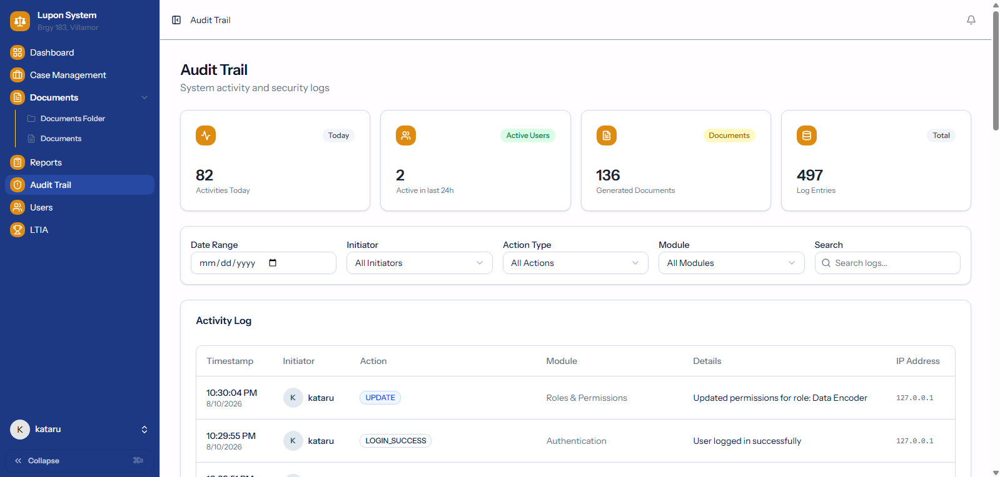](manual_images/image43.png)<br>[image43.png](manual_images/image43.png), [image70.png](manual_images/image70.png) | **Tamper Resistance:** Audit log entries are append-only. No user (including Administrator) is permitted to edit or delete audit logs. |
| **UM_ADM_10** | Audit Log Filtering & Keyword Search | 1. On Audit Trail page (`/audit`), locate filter toolbar.<br>2. Type a keyword in search bar (e.g., *"DELETE"*, *"RESTORE"*, or a specific User Name).<br>3. Select **Module** dropdown filter (e.g., *"Documents"*).<br>4. Select **Action** filter (e.g., *"SECURITY_RESTORE_REJECTED"*).<br>5. Select target date via date-picker. | Table updates asynchronously using debounced server querying, isolating records that match all active filter criteria. Pagination updates to reflect filtered count. | [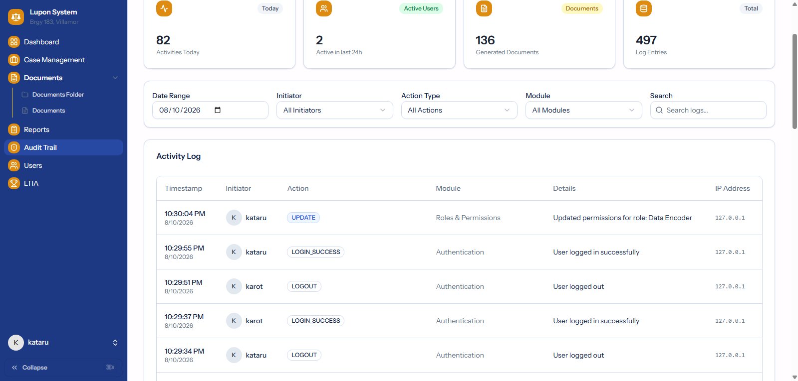](manual_images/image50.png)<br>[image50.png](manual_images/image50.png), [image48.png](manual_images/image48.png), [image41.png](manual_images/image41.png), [image3.png](manual_images/image3.png), [image28.png](manual_images/image28.png) | **Performance:** Utilizes indexed SQL lookups for rapid querying even across tens of thousands of activity rows. |
| **UM_ADM_11** | Generate Report with Empty Filter Dataset Handling | 1. Navigate to **"System Reports"** (`/system-reports`).<br>2. Under Report Configuration, set Start Date and End Date to a range with zero recorded cases (e.g., future dates).<br>3. Select Report Type: *"Monthly Case Summary"*.<br>4. Click **"Generate PDF Report"**. | System executes query, detects count is zero (0), and compiles an official PDF containing standard Barangay header, date scope, and an explicit notice: *"No matching cases found for the selected period."* The application runs gracefully without memory overflow or 500 error crashes. | [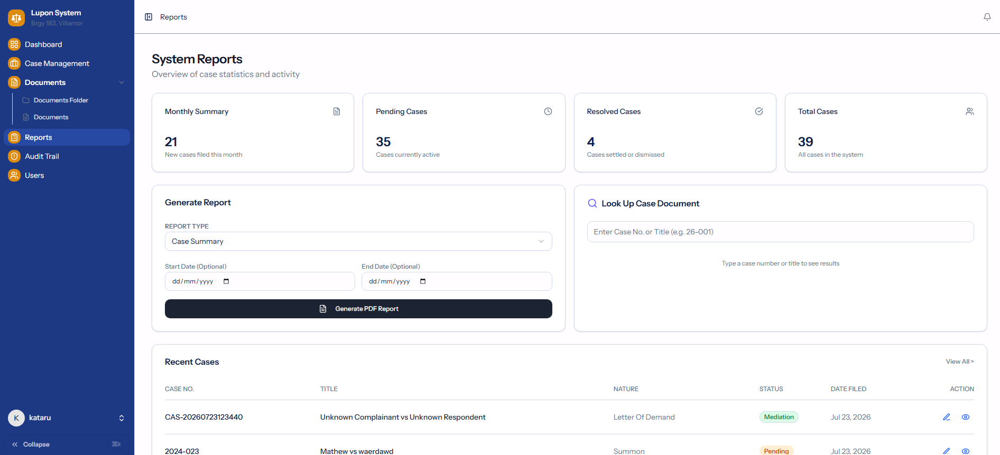](manual_images/image25.png)<br>[image25.png](manual_images/image25.png), [image14.png](manual_images/image14.png) | **Fault Tolerance:** Safe PDF handling guarantees no white-screen or server crash occurs when date queries yield zero rows. |
| **UM_ADM_12** | Generate & Export Official Barangay Reports | 1. Open **"System Reports"** (`/system-reports`).<br>2. Select report category: **Case Summary**, **Nature of Cases Breakdown**, or **Case Status Report**.<br>3. Select date range (e.g., Current Month or Full Year).<br>4. Click **"Generate PDF"**.<br>5. System compiles document and browser initiates download. | A print-ready, officially formatted PDF is generated with Republic of the Philippines letterhead, Barangay header, analytical data tables, resolution rate percentages, and certified signatory blocks for Punong Barangay and Lupon Secretary. | [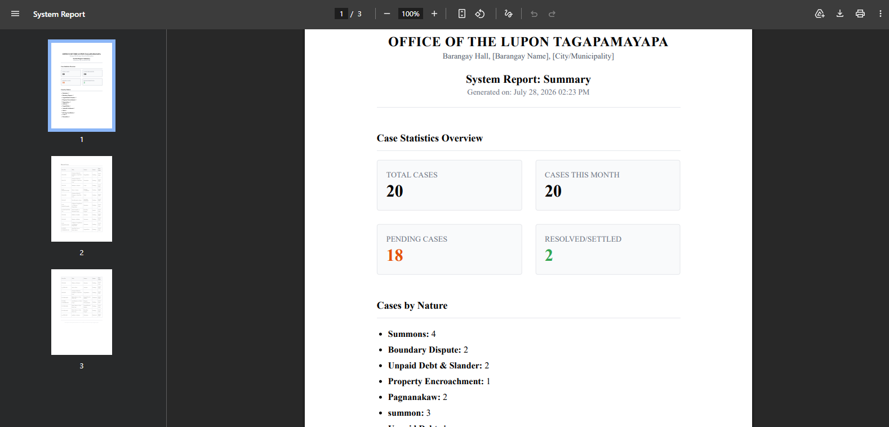](manual_images/image74.png)<br>[image74.png](manual_images/image74.png), [image29.png](manual_images/image29.png), [image76.png](manual_images/image76.png) | **Compliance:** Formatted strictly in accordance with Department of the Interior and Local Government (DILG) reporting standards. |
| **UM_ADM_13** | LTIA Governance: Set Deadline & Evaluation Phases | 1. On sidebar navigation, click **"LTIA"** (`/ltia`).<br>2. In **"Submission Deadline"** card, click date-picker and select official DILG LTIA deadline date.<br>3. Click **"Update Deadline"**.<br>4. Under **"Timeline Phases"**, click on an assessment phase (e.g., *"Phase 2: Evidence Consolidation"*).<br>5. Adjust status to *"In Progress"* or *"Completed"* and enter progress percentage.<br>6. Click **"Save Phase Changes"**. | System persists deadline to `system_settings` table, recalculates Days Remaining countdown widget, updates phase progress bars, displays green toast: *"LTIA deadline updated successfully."*, and synchronizes state across all logged-in terminals. | [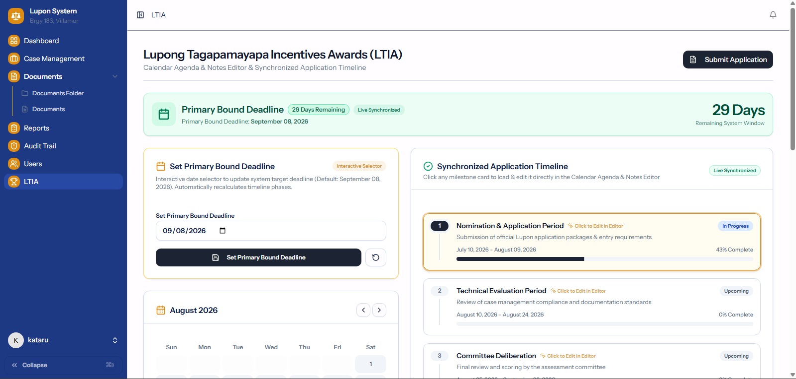](manual_images/image34.png)<br>[image34.png](manual_images/image34.png), [image67.png](manual_images/image67.png) | **Governance Focus:** Keeps Lupong Tagapamayapa on track for annual Lupong Tagapamayapa Incentives Awards evaluation. |
| **UM_ADM_14** | LTIA Governance: Manage Calendar Events | 1. Navigate to **LTIA Management** (`/ltia`).<br>2. Switch to **"Calendar & Events"** tab.<br>3. Click **"+ Add Event"** button.<br>4. Input Event Title (e.g., *"DILG Municipal Assessment Team On-Site Inspection"*), Event Date, and notes.<br>5. Click **"Save Event"**. | The new event is saved to database, rendered on interactive calendar grid with status badges (`Upcoming`/`Active`), and added to executive reminder summary list. | [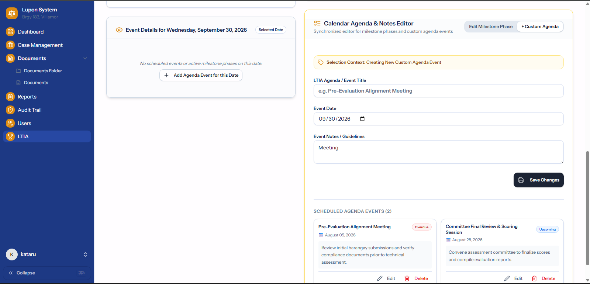](manual_images/image69.png)<br>[image69.png](manual_images/image69.png), [image87.png](manual_images/image87.png) | **Reminders:** Alerts staff of upcoming compliance hearings, document submissions, and validation schedules. |
| **UM_ADM_15** | Database Restore Attempt in Administrator View-Only Mode | 1. Log in as Administrator.<br>2. Navigate to **Settings** > **Backup & Restore** (`/settings/system` or `/settings/backup`).<br>3. Choose a valid `.json` database backup file from local storage.<br>4. Click **"Restore Database"** button. | System intercepts request, blocks execution at controller level, displays warning alert banner: *"Administrators are in View-Only mode."*, and logs a `SECURITY_RESTORE_REJECTED` security event in Audit Trail with Admin ID and IP address. | [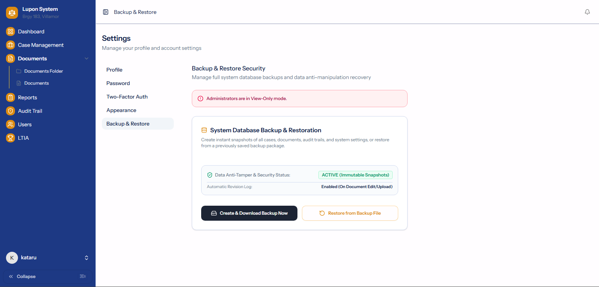](manual_images/image89.png)<br>[image89.png](manual_images/image89.png) | **Separation of Duties (SoD):** Administrators supervise and audit; transactional database restoration is reserved for authorized Data Encoders to prevent administrative tampering. |
| **UM_ADM_16** | Secure Administrator Session Termination (Logout) | 1. Click user profile avatar or dropdown at top-right corner of interface.<br>2. Click **"Log Out"** button. | System terminates session, invalidates authentication tokens, clears local user cache, logs `LOGOUT` in Audit Trail, and redirects browser to Login view (`/login`). Subsequent attempts to use browser "Back" button are blocked. | [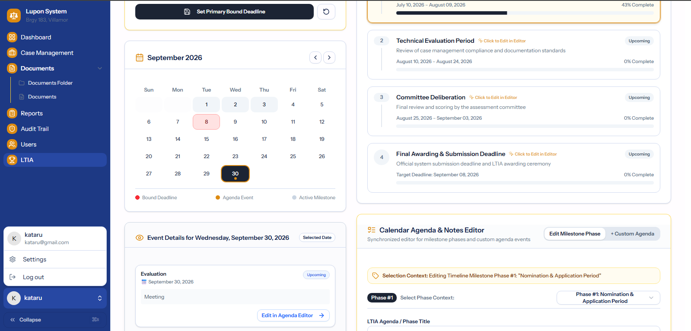](manual_images/image30.png)<br>[image30.png](manual_images/image30.png), [image47.png](manual_images/image47.png) | **Session Hygiene:** Completely invalidates session cookie to prevent unauthorized physical terminal takeover. |

#### Administrator Module Summary
*This module enables administrative users to securely log into the system, monitor real-time dashboard case analytics and settlement metrics, manage master personnel account records, configure dynamic role-based permissions, monitor comprehensive system audit trail activity logs, generate and export official barangay case summary reports, and oversee LTIA evaluation phases and submission deadlines, providing administrators with complete operational control, governance oversight, and security management.*

---

## 3. DATA ENCODER WORKFLOW MANUAL

```
Republic of the Philippines
NATIONAL AVIATION ACADEMY OF THE PHILIPPINES
The National Professional Institution for Aviation
INSTITUTE OF COMPUTER STUDIES
```

### TABLE 2: USER MANUAL PROCEDURE FOR MODULE: DATA ENCODER WORKFLOW

| Manual ID | Procedure Title | Step-by-Step User Instructions (Actions) | Expected System Response & Visual Output | Screenshot / Image Reference | Operational Guidelines & Remarks |
| :--- | :--- | :--- | :--- | :--- | :--- |
| **UM_ENC_01** | Data Encoder Authentication & Session Initiation | 1. Open web browser and go to `/login`.<br>2. Enter registered Data Encoder email (e.g., `encoder@example.com`).<br>3. Enter valid password.<br>4. Click **"Log in"**. | System authenticates user, assigns session rights, and redirects directly to **Case Management Dashboard** (`/cases` or `/dashboard`). Navigation drawer displays encoder-accessible modules: Cases, Documents, Templates, and System Settings. | [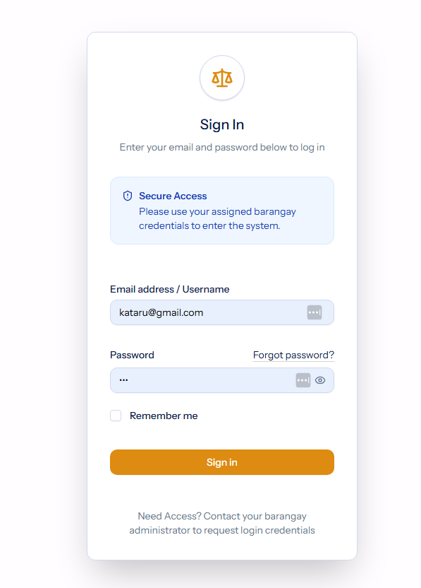](manual_images/image6.png)<br>[image6.png](manual_images/image6.png), [image58.png](manual_images/image58.png) | **Role Assignment:** Encoder identity is assigned to all newly filed cases, document uploads, and edits for traceability. |
| **UM_ENC_02** | Role Access Restriction Verification (Security Guard) | 1. Log in as Data Encoder.<br>2. Manually enter administrative route URLs in browser address bar: `http://lupon.test/users` or `http://lupon.test/audit`.<br>3. Press **Enter**. | System middleware intercepts unauthorized route request, terminates traversal, and renders a secure **403 Forbidden** error page stating access is restricted to Administrators only. | [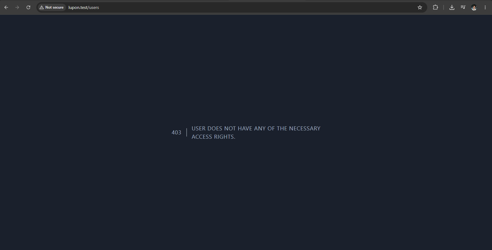](manual_images/image5.png)<br>[image5.png](manual_images/image5.png), [image66.png](manual_images/image66.png) | **OWASP Protection:** Enforces strict Broken Access Control (OWASP #1) defense, prohibiting URL tampering or privilege escalation. |
| **UM_ENC_03** | Encode & File New Barangay Case via KP Form | 1. From navigation sidebar, click **"Documents"** > **"Templates"** (`/documents/templates`).<br>2. Locate **"Complaint Form (KP Form No. 7)"** and click **"Use Template"** / **"Fill Form"**.<br>3. Fill in required fields: **Case Number** (e.g., `KP-2026-001`), **Complainant Name(s)**, **Respondent Name(s)**, **Nature of Dispute** (e.g., *"Boundary Dispute / Oral Defamation"*), and **Date Filed**.<br>4. Enter dispute narrative.<br>5. Click **"Generate & Save Document"**. | System writes new record to `cases` table with initial status `"Mediation"`, creates associated legal document record, generates formatted KP Form 7 document, updates active case count, and redirects to Case Directory with success banner. | [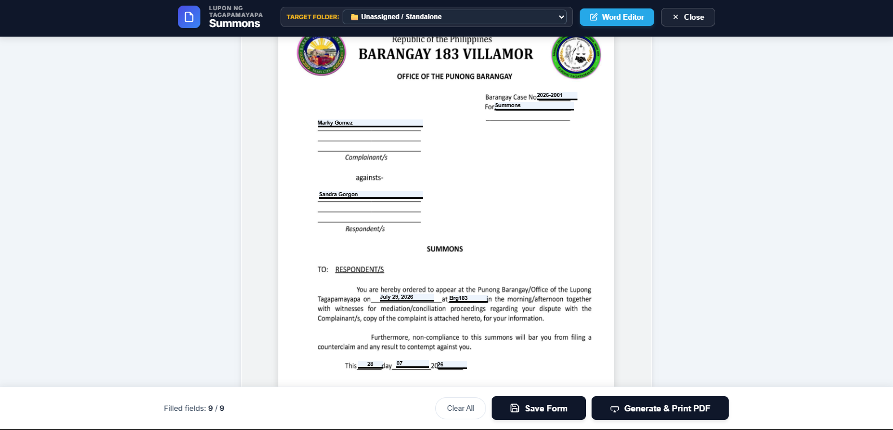](manual_images/image37.png)<br>[image37.png](manual_images/image37.png), [image26.png](manual_images/image26.png), [image12.png](manual_images/image12.png) | **Dual-Action Filing:** Automatically registers the case in the master directory while simultaneously generating official legal notice. |
| **UM_ENC_04** | Case Encoding: Duplicate Case Number Validation | 1. Open KP Form 7 or Case Creation modal.<br>2. In **Case Number** field, enter an identifier that already exists in the system (e.g., existing case `KP-2026-001`).<br>3. Fill out other fields and click **"Generate & Save Document"**. | System denies form submission, scrolls to Case Number input, outlines box in red, and displays validation notification: *"Case Number already exists in the records."* No duplicate entry is stored in database. | [](manual_images/image65.png)<br>[image65.png](manual_images/image65.png), [image75.png](manual_images/image75.png), [image88.png](manual_images/image88.png) | **Data Integrity:** Database enforces unique constraint on `cases.case_number` to guarantee distinct case tracking. |
| **UM_ENC_05** | Case Encoding: Excessive Text Field Overflow Handling | 1. In Case Form Editor, locate **"Nature of Dispute / Details"** narrative textarea.<br>2. Paste an extensive text body containing over 2,000+ characters.<br>3. Click **"Preview PDF"** or **"Generate & Save Document"**. | System dynamically sanitizes text, executes auto-wrapping across margins, and renders multi-page document pagination seamlessly without truncating characters or breaking layout boundaries. | [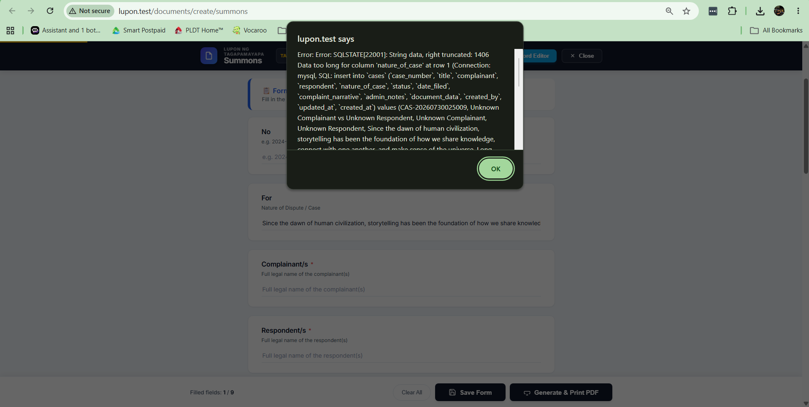](manual_images/image61.png)<br>[image61.png](manual_images/image61.png) | **Layout Resilience:** Dynamic styling prevents text from running off PDF margins or overlapping official signatory stamps. |
| **UM_ENC_06** | Search & Filter Master Case Records | 1. Navigate to **"Cases"** (`/cases`).<br>2. In top search bar, enter search term (Case Number, Complainant, or Respondent name).<br>3. Use dropdown filters to isolate cases by **Status** (`Mediation`, `Conciliation`, `Settled`, `Resolved`) or **Month Filed**.<br>4. Toggle sort order by date. | Table updates in real-time without full page reload. Matching records are displayed with dynamic color-coded status badges, party names, filing dates, and document count chips. | [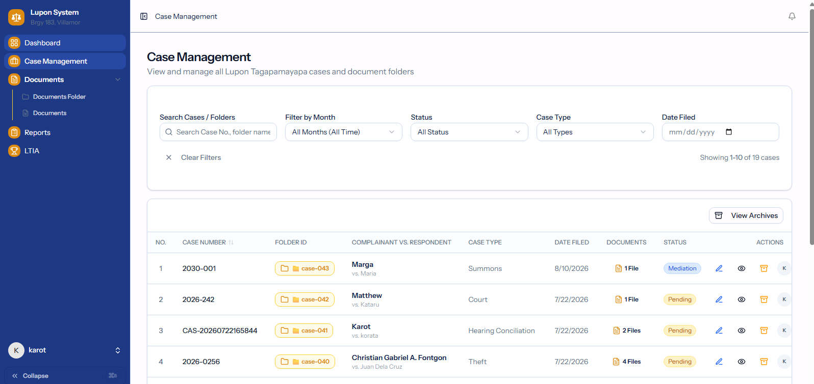](manual_images/image95.png)<br>[image95.png](manual_images/image95.png), [image54.png](manual_images/image54.png), [image57.png](manual_images/image57.png), [image77.png](manual_images/image77.png), [image53.png](manual_images/image53.png) | **Live Synchronization:** Uses Inertia partial reloads for instantaneous responses even with extensive case databases. |
| **UM_ENC_07** | Inspect Case Details Drawer & History | 1. On Case Management table (`/cases`), click anywhere on a case record row.<br>2. Observe slide-over inspection drawer that opens from right screen margin. | Side drawer renders comprehensive case dossier: Case Number, Filing Date, Complete Narrative, Complainant & Respondent Contact Details, Assigned Conciliation Officer, Interactive Case Timeline, and a list of all attached KP legal documents with instant view/print buttons. | [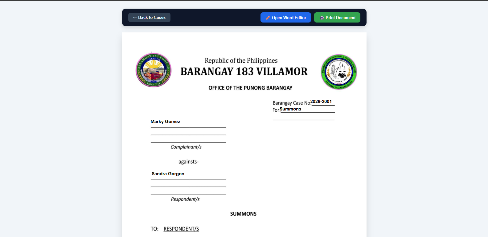](manual_images/image1.png)<br>[image1.png](manual_images/image1.png) | **Non-Disruptive View:** Allows encoder to inspect full case details without losing current search/filter state in main table. |
| **UM_ENC_08** | Update Conciliation Lifecycle Case Status | 1. In Case Management directory (`/cases`), click **"Edit Status"** (pencil/edit icon) on target case.<br>2. **Edit Case Status Dialog** appears showing current status.<br>3. Select updated status from dropdown: `Pending`, `Mediation`, `Conciliation`, `Arbitration`, `Settled`, `Resolved`, `Dismissed`, or `Certified (Court Action)`.<br>4. Click **"Save Status Changes"**. | Modal closes, updated status badge reflects immediately with corresponding color coding, dashboard metrics update live, and an `UPDATE_STATUS` event is logged to Audit Trail. | [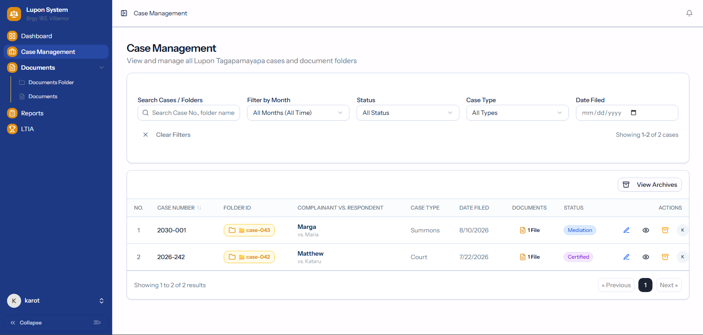](manual_images/image24.png)<br>[image24.png](manual_images/image24.png), [image82.png](manual_images/image82.png), [image73.png](manual_images/image73.png) | **Legal Lifecycle Tracking:** Accurately reflects Katarungang Pambarangay stages (from Barangay Captain mediation to Pangkat conciliation or Court Certification). |
| **UM_ENC_09** | Archive Completed or Inactive Case Record | 1. Locate a resolved, settled, or dismissed case in `/cases`.<br>2. Click row action menu (three dots icon) or **"Archive"** button.<br>3. In confirmation dialog, confirm archival prompt. | System executes soft-deletion (`deleted_at` timestamp recorded), removes case from active Case Directory, updates active case counter, and archives all linked documents safely without permanent data destruction. | [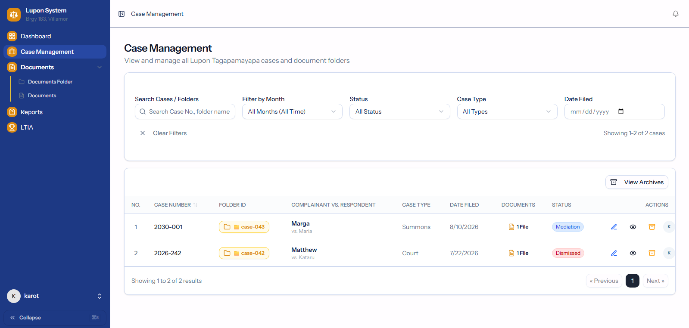](manual_images/image22.png)<br>[image22.png](manual_images/image22.png), [image31.png](manual_images/image31.png), [image68.png](manual_images/image68.png), [image10.png](manual_images/image10.png) | **Soft-Delete Protection:** Preserves complete legal history while keeping active working directory decluttered and focused. |
| **UM_ENC_10** | View & Restore Archived Case Records | 1. In Cases menu, click **"Case Archives"** tab (`/cases/archive`).<br>2. Browse list of archived cases.<br>3. Locate target case and click **"Restore Case"**.<br>4. Confirm restoration prompt. | System sets `deleted_at = NULL`, removes case from archive list, restores case and all linked forms back to active Case Directory (`/cases`), and logs `CASE_RESTORED` in Audit Trail. | [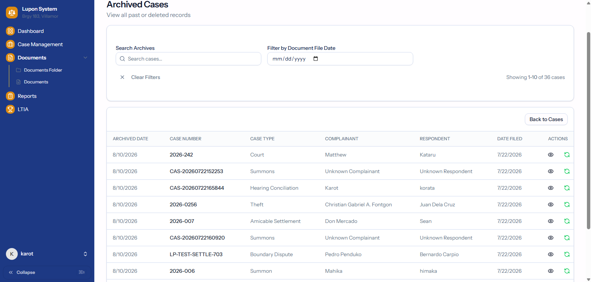](manual_images/image15.png)<br>[image15.png](manual_images/image15.png), [image86.png](manual_images/image86.png), [image7.png](manual_images/image7.png), [image11.png](manual_images/image11.png) | **Accidental Deletion Prevention:** Any archived record can be restored instantly with 100% of historical timeline and documents intact. |
| **UM_ENC_11** | Navigate Document Drive & Digital Folders | 1. Click **"Documents"** > **"Document Folders"** (`/documents/folders`) on sidebar.<br>2. View organized file drive hierarchy. | System displays interactive digital folder grid: Auto-generated case folders (named by Case Number and Parties), general legal categories, and custom administrative folders, displaying file counts and last modified dates. | [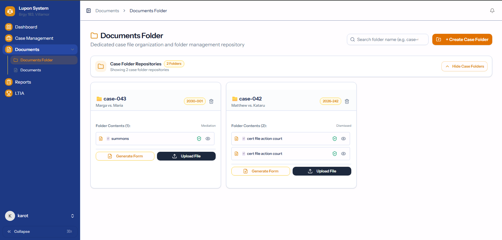](manual_images/image97.png)<br>[image97.png](manual_images/image97.png) | **Organized Storage:** Groups all notices, summonses, affidavits, and evidence files systematically under their parent case folder. |
| **UM_ENC_12** | Create Digital Folder & Upload Evidence Files | 1. In Document Folders (`/documents/folders`), click **"+ Create Folder"**.<br>2. Input Folder Name (e.g., *"Case-2026-001 Evidence & Photos"*).<br>3. Click **"Save"**.<br>4. Open created folder, click **"Upload Files"**, select scanned PDF or JPG evidence from local PC, and click **"Upload"**. | Folder is created in database storage, files are encrypted and saved under storage directory, and uploaded file cards appear with file size, upload timestamp, and preview thumbnails. | [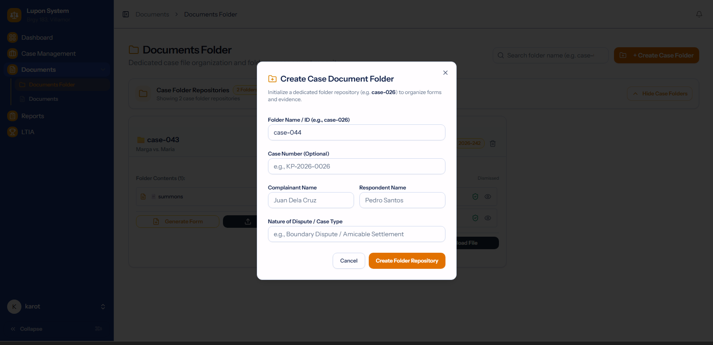](manual_images/image19.png)<br>[image19.png](manual_images/image19.png), [image84.png](manual_images/image84.png) | **Storage Structure:** Automatically associates uploads with active case ID for quick retrieval during hearings. |
| **UM_ENC_13** | Upload Security: Reject Executable / Prohibited Files | 1. In Document Drive or Evidence Upload dialog, attempt to select an executable, script, or unsafe file (`.exe`, `.bat`, `.js`, `.php`, `.vbs`).<br>2. Click **"Upload"**. | Client and server security validators reject file instantly, block transmission, outline upload zone in red, and display security warning: *"Invalid file type. Only PDF, PNG, and JPG files are accepted."* | [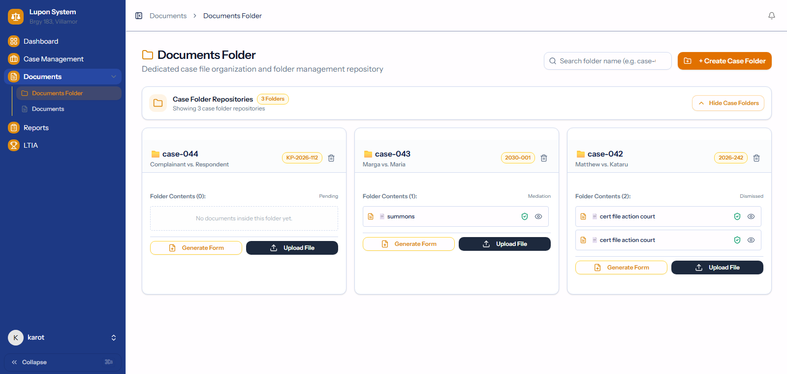](manual_images/image55.png)<br>[image55.png](manual_images/image55.png), [image38.png](manual_images/image38.png) | **Malware Defense:** Enforces strict MIME-type and extension validation to prevent remote code execution (RCE) on server. |
| **UM_ENC_14** | Browse Standard Katarungang Pambarangay (KP) Templates | 1. Click **"Documents"** > **"Templates"** (`/documents/templates`).<br>2. Browse standardized KP legal form library. | System presents complete catalog of standard KP Form cards: KP Form 7 (Complaint), KP Form 9 (Summons), KP Form 16 (Amicable Settlement), Affidavit of Withdrawal, Notice of Hearing (Mediation / Conciliation), Certificate to File Action (Court), Motion for Execution, and Officers Return. | [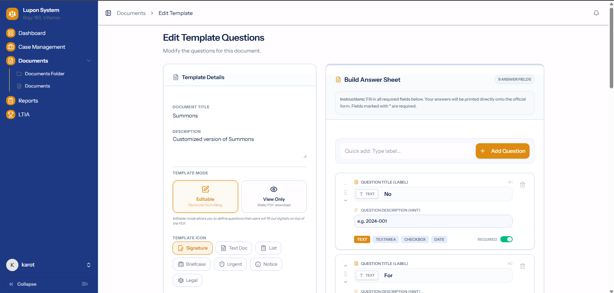](manual_images/image96.png)<br>[image96.png](manual_images/image96.png) | **Standard Compliance:** All templates strictly comply with Katarungang Pambarangay Law (RA 7160 / Local Government Code). |
| **UM_ENC_15** | Select, Preview & Edit KP Form Template | 1. In Templates catalog (`/documents/templates`), click on desired template card (e.g., *"KP Form No. 9 - Summons"*).<br>2. System opens interactive **Document Form Editor**.<br>3. Fill in Officer Name, Hearing Date & Time, Barangay Hall Location, and Recipient Details.<br>4. Click **"Print Preview"** or **"Generate PDF"**. | Document Editor displays real-time typographic rendering matching official DILG letterhead. Generates high-resolution downloadable PDF ready for physical printing and service. | [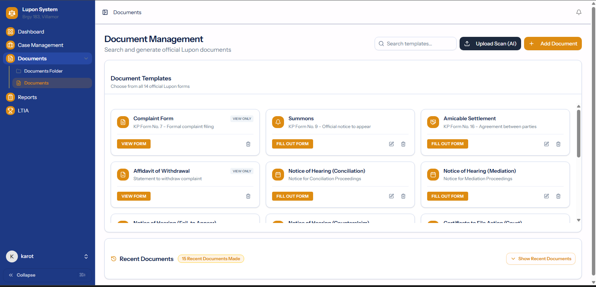](manual_images/image16.png)<br>[image16.png](manual_images/image16.png), [image8.png](manual_images/image8.png), [image56.png](manual_images/image56.png) | **Auto-Fill Integration:** Selecting an existing case automatically pre-populates case number, complainant, and respondent details. |
| **UM_ENC_16** | Auto-Align Document Layout with AI Assist | 1. Inside Document Editor, input customized narrative or case particulars.<br>2. If spacing, margins, or paragraph indentations appear uneven, click **"Auto-Align AI"** button on editor toolbar.<br>3. System analyzes typographic layout. | Gemini AI backend adjusts document text alignment, paragraph margins, signature block positioning, and placeholder spacing to standard legal proportions, displaying toast: *"Document layout aligned successfully."* | [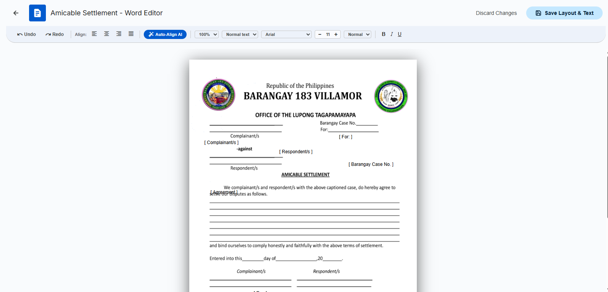](manual_images/image91.png)<br>[image91.png](manual_images/image91.png), [image2.png](manual_images/image2.png) | **Aesthetic Polish:** Guarantees that generated barangay summonses and agreements maintain uniform, professional legal typography. |
| **UM_ENC_17** | Edit Custom Document Template Structure | 1. In Templates view (`/documents/templates`), click **"Edit Template"** on an editable form card.<br>2. In template builder, modify header phrasing, body legal clauses, or standard footer text.<br>3. Click **"Save Template"**. | Updated template layout structure is saved to `form_layouts` table, logged in Audit Trail, and applied to all future documents generated from that template. | [](manual_images/image16.png)<br>[image16.png](manual_images/image16.png), [image52.png](manual_images/image52.png) | **Customization:** Allows Barangay Secretary to customize official notices to fit specific municipal ordinances or local barangay seals. |
| **UM_ENC_18** | Delete Document or Custom Folder with Confirmation | 1. Navigate to Document Folders or Document list.<br>2. Click **"Delete"** (trash can icon) button on target file or custom folder.<br>3. In confirmation dialog, review warning prompt and click **"Confirm Delete"**. | Document/folder record is soft-deleted or removed from storage, UI list updates immediately, and a `DELETE_DOCUMENT` record is registered in Audit Trail. | [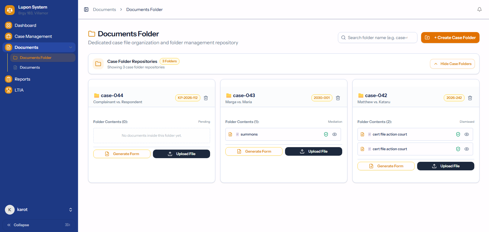](manual_images/image17.png)<br>[image17.png](manual_images/image17.png), [image80.png](manual_images/image80.png), [image18.png](manual_images/image18.png) | **Accidental Action Prevention:** Requires explicit confirmation dialog before executing file or folder deletion. |
| **UM_ENC_19** | Upload Physical Scan with Gemini AI Metadata Extraction | 1. Go to **"Documents"** and click **"Upload Scan (AI)"** button.<br>2. Select a scanned physical image (PNG/JPG) or PDF of a paper KP complaint.<br>3. Click **"Scan Document"**.<br>4. Review extracted fields populated in verification form: **Case Number**, **Complainant Name**, **Respondent Name**, **Form Type**, and **Nature of Dispute**.<br>5. Confirm/adjust details and click **"Save to Database"**. | Gemini 2.5 Flash API parses optical handwriting and text, extracts metadata with high confidence, saves scanned file in permanent storage, and creates a linked case record automatically in active directory. | [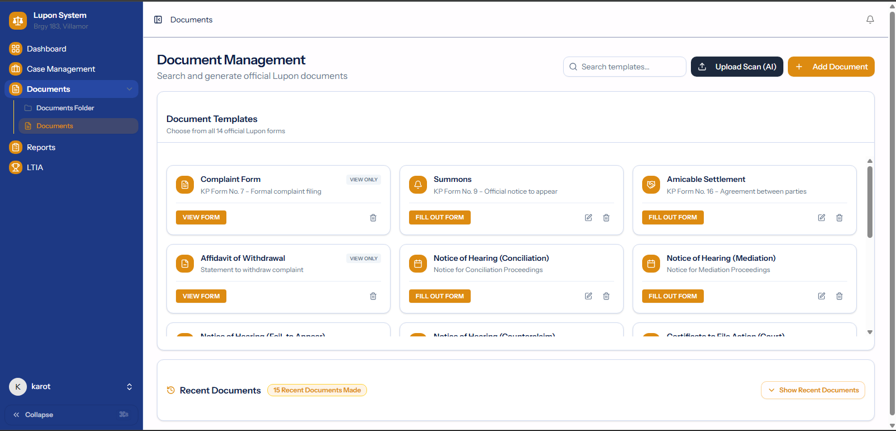](manual_images/image35.png)<br>[image35.png](manual_images/image35.png), [image33.png](manual_images/image33.png), [image83.png](manual_images/image83.png), [image71.png](manual_images/image71.png), [image21.png](manual_images/image21.png), [image20.png](manual_images/image20.png) | **Productivity Boost:** Eliminates repetitive manual typing of paper forms received at barangay hall desk. Weekly quota is tracked (20 scans/week). |
| **UM_ENC_20** | AI Scan Ingestion: Offline / Wi-Fi Disconnection Guard | 1. Disconnect computer from internet or turn off Wi-Fi.<br>2. Attempt to upload a scanned document via **"Upload Scan (AI)"** and click **"Scan Document"**.<br>3. System detects network unavailability. | System intercepts call before crashing, preserves uploaded file safely in local temp cache, and displays amber alert banner: *"Internet connection required for Gemini AI metadata extraction. Please check your network or enter data manually."* | [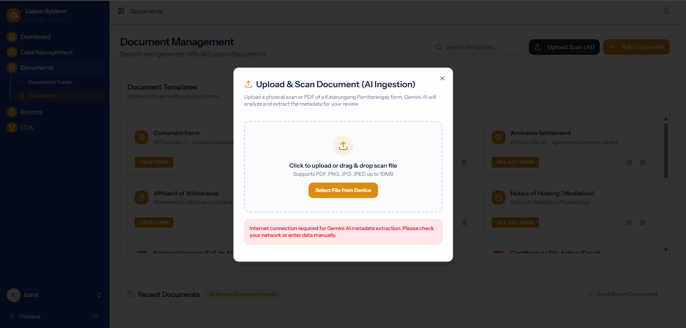](manual_images/image40.png)<br>[image40.png](manual_images/image40.png) | **Resilience:** System guarantees no data loss when internet drops; encoders can seamlessly toggle to manual data entry mode. |
| **UM_ENC_21** | Full Database Restoration from Backup JSON Package | 1. Log in as Data Encoder.<br>2. Navigate to **"Settings"** > **"Backup & Restore"** (`/settings/system`).<br>3. Under Restore section, select a valid system `.json` backup file created by Lupon CMS.<br>4. Click **"Restore Database"**.<br>5. Confirm system restoration prompt. | Backend initiates database transaction, parses JSON tables (`cases`, `documents`, `system_settings`), updates existing records, restores missing entries, commits transaction, displays green success notification: *"Database successfully restored."*, and logs `DATABASE_RESTORED` in Audit Trail. | [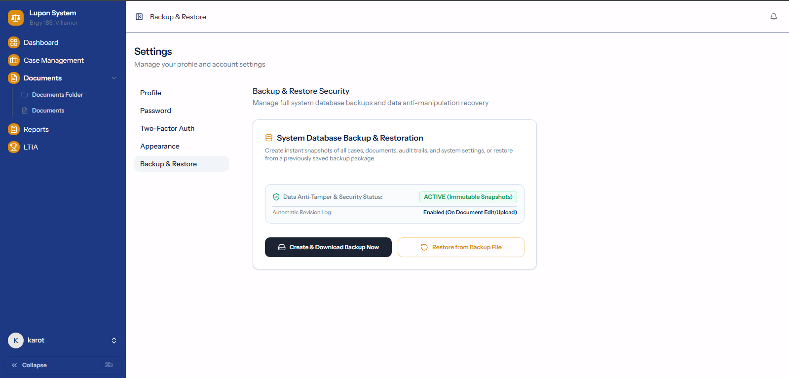](manual_images/image79.png)<br>[image79.png](manual_images/image79.png), [image49.png](manual_images/image49.png) | **Disaster Recovery:** Enables complete restoration of barangay records in event of local hardware failure or operating system reinstall. |
| **UM_ENC_22** | Download Full System Database JSON Backup Package | 1. Navigate to **"Settings"** > **"Backup & Restore"** (`/settings/system`).<br>2. In Database Backup panel, click **"Create & Download Backup Now"**.<br>3. System serializes tables into formatted JSON. | Browser initiates download of file named `lupon_database_backup_YYYY-MM-DD_HH-mm-ss.json` containing complete serialized records of all cases, documents, version history, system settings, and recent audit logs with metadata signature. | [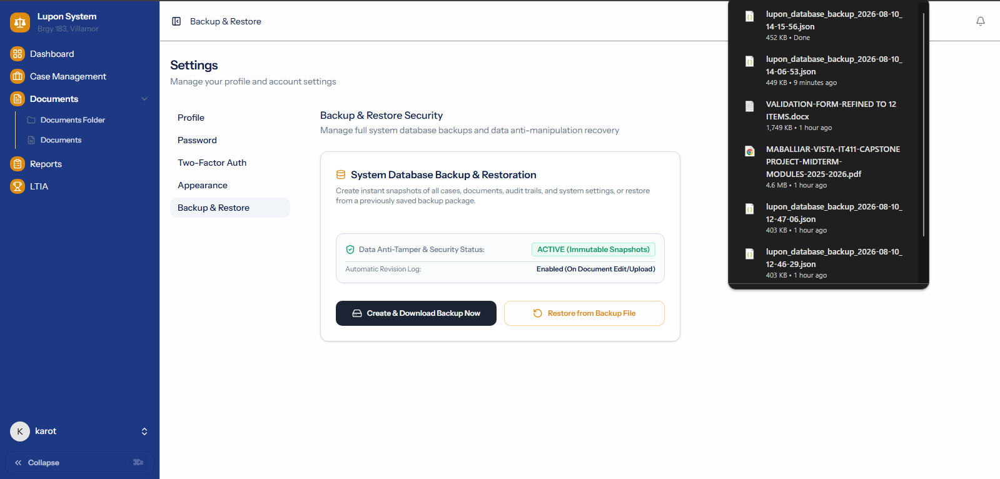](manual_images/image90.png)<br>[image90.png](manual_images/image90.png) | **Data Sovereignty:** Enables regular off-site backup storage on flash drives or secure external storage for barangay records. |
| **UM_ENC_23** | Backup Security: Reject Invalid or Tampered Files | 1. On Backup & Restore view (`/settings/system`), attempt to upload a non-JSON file (e.g., `.pdf`, `.docx`, `.txt`) or an arbitrary untrusted `.json` file lacking Lupon CMS signature.<br>2. Click **"Restore Database"**. | System inspects file extension, MIME header, and system metadata signature. Denies backend processing, displays red alert: *"Security rejected: Only .json database backup packages generated by Lupon are accepted."*, and logs `SECURITY_RESTORE_REJECTED` in Audit Trail. | [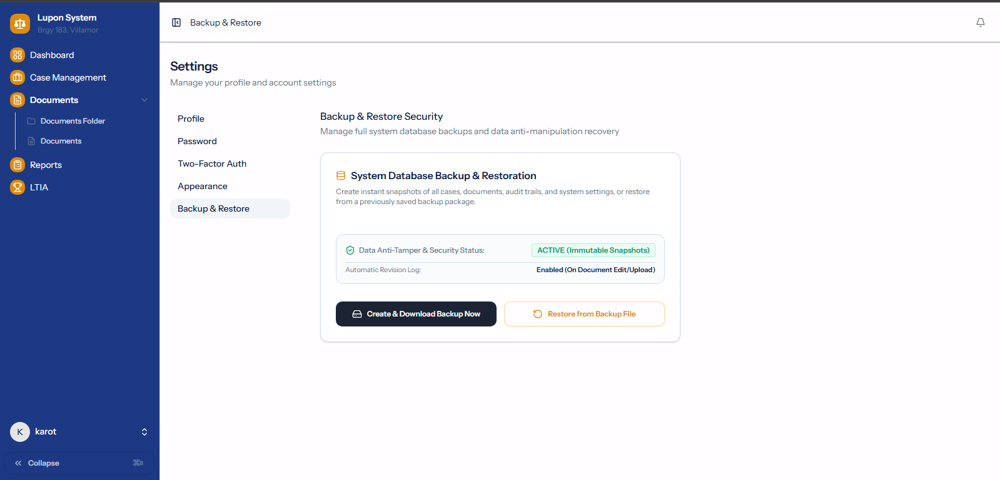](manual_images/image27.png)<br>[image27.png](manual_images/image27.png), [image51.png](manual_images/image51.png), [image59.png](manual_images/image59.png) | **Anti-Tamper Guard:** Guarantees malicious or corrupt files cannot corrupt database tables or inject unauthorized payloads. |
| **UM_ENC_24** | Document Version History Inspection & Restore | 1. Open any generated legal document in Documents directory.<br>2. Click **"Version History"** (clock/history icon) on document toolbar.<br>3. Browse chronological snapshot versions with author names, timestamps, and modification summaries.<br>4. Select a previous historical version and click **"Restore Version"**. | System rolls back current document content to selected historical snapshot, refreshes document preview immediately, displays green toast: *"Version restored successfully."*, and writes `DOCUMENT_RESTORED` to Audit Trail. | [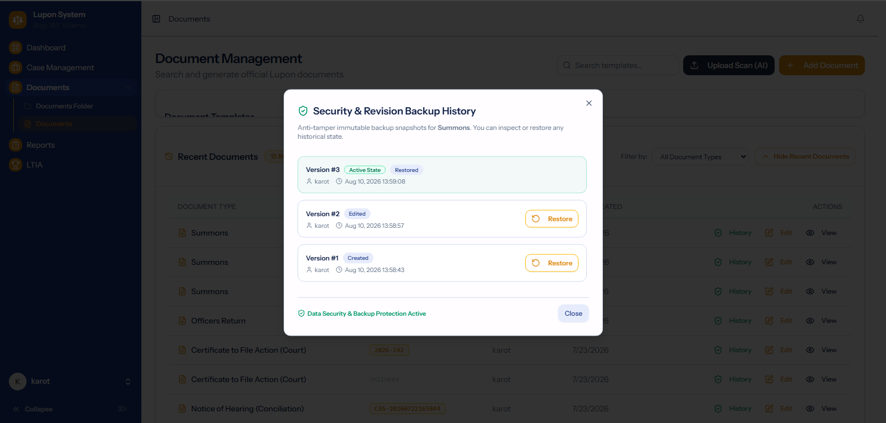](manual_images/image63.png)<br>[image63.png](manual_images/image63.png), [image4.png](manual_images/image4.png), [image62.png](manual_images/image62.png) | **Anti-Tamper & Integrity:** Protects against unauthorized alterations or accidental overwrites of conciliation agreement texts. |

#### Data Encoder Module Summary
*This module enables data encoder personnel to securely authenticate into the system, encode and manage barangay conciliation case records, perform advanced filtering and timeline inspections, organize case documents into custom digital folders, upload physical document scans for automated Gemini AI metadata extraction and ingestion, auto-fill standard Katarungang Pambarangay (KP) legal form templates with automated AI layout alignment, and archive or restore completed case entries, providing staff with an efficient, streamlined case processing and document management workflow.*

---

## 4. SYSTEM TROUBLESHOOTING & SECURITY INCIDENT REFERENCE

```
Republic of the Philippines
NATIONAL AVIATION ACADEMY OF THE PHILIPPINES
The National Professional Institution for Aviation
INSTITUTE OF COMPUTER STUDIES
```

### 4.1 Common System Validation Messages & Resolutions

| Incident / Error Message | Root Cause | Recommended User Action / Resolution |
| :--- | :--- | :--- |
| **"These credentials do not match our records."** | Incorrect email or password entered during login. | Verify Caps Lock is OFF. Check spelling of registered email. Contact Administrator if password reset is needed. |
| **"403 Forbidden - Access Denied"** | Data Encoder attempted to access Administrator-only routes (`/users`, `/audit`). | Return to allowed areas (Cases, Documents). Do not manually type administrative URLs into the browser address bar. |
| **"Case Number already exists in the records."** | An existing case record in the database already utilizes the entered Case Number. | Check the Case Directory (`/cases`) for existing case number format. Assign next sequential case identifier (e.g., `KP-2026-042`). |
| **"Administrators are in View-Only mode."** | Administrator attempted to execute transactional document filing or database restore. | Log in using an authorized Data Encoder account to perform case editing, file uploads, and database restorations. |
| **"Internet connection required for Gemini AI metadata extraction."** | Local computer lost internet connectivity during an AI document scan upload. | Check network/Wi-Fi router. Reconnect to internet and retry scan, or use manual form entry via Templates tab. |
| **"Weekly AI upload limit reached (20/20 files used this week)."** | Barangay has exhausted the weekly Gemini AI optical scanning quota allocation. | Use manual document creation via **Documents** > **Templates** until quota resets on Monday at 00:00 PST. |
| **"Security rejected: Only .json database backup packages generated by Lupon are accepted."** | An unverified, corrupted, or non-JSON file was selected for database restoration. | Ensure the selected file was generated using **"Create & Download Backup Now"** and has the `.json` extension. |
| **"Invalid file type. Only PDF, PNG, and JPG files are accepted."** | User attempted to upload an unsupported or prohibited file format (`.exe`, `.bat`, `.docx`). | Convert evidence document to PDF, JPG, or PNG before uploading into Document Folders. |

### 4.2 Security Governance & Data Privacy Safeguards
1. **OWASP Top 10 Broken Access Control Defense:** Every web route is gated with server-side middleware (`auth`, `verified`, `role:Administrator`, `role:Data Encoder`). Client-side button hiding is backed by uncompromising backend authorization checks.
2. **Audit Trail Accountability:** Every state-altering action (login, creation, update, archival, restoration, deletion, security rejection) is permanently recorded with the actor's user ID, timestamp, and client IP address.
3. **Philippine Data Privacy Act of 2012 (RA 10173) Compliance:** All resident personal data, dispute narratives, and case files are stored behind authenticated sessions, ensuring strictly confidential conciliation proceedings.

---

## 5. GLOSSARY OF LEGAL & TECHNICAL TERMS

- **Katarungang Pambarangay (KP):** The barangay justice system in the Philippines established by Republic Act No. 7160 (Local Government Code of 1991) to resolve community disputes amicably without court litigation.
- **KP Form No. 7 (Complaint Form):** The initial written complaint submitted by a resident to commence mediation before the Punong Barangay.
- **KP Form No. 9 (Summons):** Official notice requiring the respondent to appear before the Barangay Captain for mediation proceedings.
- **KP Form No. 16 (Amicable Settlement):** The written and signed agreement reached by the disputing parties, which possesses the force and effect of a final court judgment after 10 days.
- **Certificate to File Action (CFA):** Official certification issued when conciliation fails, authorizing parties to file their case before the regular trial court.
- **LTIA (Lupong Tagapamayapa Incentives Awards):** Annual nationwide performance evaluation conducted by the DILG assessing barangay conciliation efficiency and documentation quality.
- **RBAC (Role-Based Access Control):** Security mechanism restricting system operations based on assigned organizational roles (`Administrator` vs. `Data Encoder`).
- **Gemini 2.5 Flash:** Multimodal artificial intelligence model utilized by Lupon CMS to extract structured text, party names, and case numbers from paper document scans.
- **Soft-Deletion:** Database practice marking records as archived (`deleted_at`) rather than permanently deleting them from the disk, allowing instant recovery.
